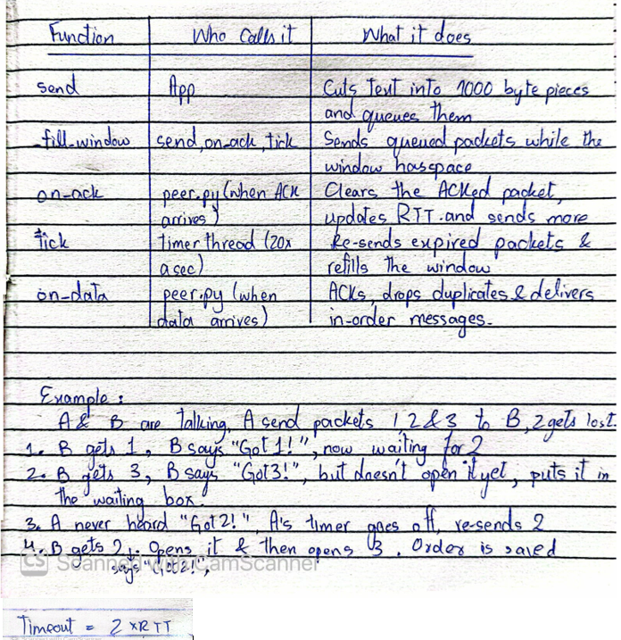

# Javeria's Daily Log - CN Project
**Role:** Protocol and Reliability Lead
**Files I own:** `protocol.py`, `reliable.py`

---

## Day 1: 20 November (J2 & J3)
**Goal:** Understand the 22-byte header and the Reliable Channel (ACK/Timeout logic).

### 🛠️ What I did today:
- [x] Ran `python selftest.py` (Result: ALL TESTS PASSED).
- [x] Read `protocol.py` and drew the 22-byte header on paper.
- [x] Ran the CRC test in the terminal and took a screenshot (`javeria_crc_proof.png`).
- [x] Read `reliable.py` and filled out the function table.
- [x] Wrote down the 3-packet loss story (how duplicates are handled and order is saved).
- [x] Wrote down the RTT/Timeout formula.

### 📝 My Notes (J2: Protocol Header):
**The 9 Boxes (22 bytes total):**
1. version (1 B)
2. type (1 B)
3. flags (1 B)
4. stream (1 B)
5. sender (4 B)
6. seq (4 B)
7. ack (4 B)
8. length (2 B)
9. crc (4 B)

**CRC Proof:**
When I ran the test script, it printed `24` (22 header + 2 payload). When I flipped one bit, `parse_packet` returned `None`, proving the CRC32 caught the corruption.

### 📝 My Notes (J3: Reliable Channel):
| Function | Who calls it | What it does (in one sentence) |
| :--- | :--- | :--- |
| `send` | App (chat, download) | Cuts message into 1000-byte pieces and queues them. |
| `_fill_window` | send, on_ack, tick | Sends queued packets while  the window has space. |
| `on_ack` | peer.py (when ACK arrives) | Clears the ACKed packet, updated RTT and sends more. |
| `tick` | Timer thread (20 times a sec) | Resends expired packets and refills the window. |
| `on_data` | peer.py (when data arrives) | ACKs, drops duplicates and delivers in order messages. |

**The Lost Packet Story (Seq 1, 2, 3 - Packet 2 lost):**
1. B gets 1, ACKs 1.
2. B gets 3, ACKs 3, but buffers 3 (because expected is 2).
3. A times out on 2, resends 2.
4. B gets 2, delivers 2, then delivers the buffered 3. Order is preserved!

**RTT Formula:**
`rtt = 0.875 * rtt + 0.125 * sample`
`timeout = 2 * rtt`

### 🚧 Blockers / Questions for the team:
- N/A

---

## Day 2: 21 November (J4)
**Goal:** Write the unit test (`test_reliable.py`).

### 🛠️ What I did today:
- [x] Created `test_reliable.py` with 20% packet loss.
- [x] Ran the test. Received all 100 messages in order!
- [x] Took screenshot (`javeria_unit_test.png`).
- [x] Did the group teach-in for `protocol.py` and `reliable.py`.

### 📝 My Notes:
- The test proves reliability works. Even with 20% loss, the window, ACKs, and timeouts fixed it.
- Retransmissions: (write the number the terminal gave you)
- Duplicates dropped: (write the number the terminal gave you)

---

## Day 3: 22 November (J5)
**Goal:** Break things on purpose to understand trade-offs.

### 🛠️ What I did today:
- [ ] **Exp 1 (No Window):** Changed `WINDOW = 1` in `reliable.py`. Observed: Download time got way bigger. Taught me: Window of 1 is stop-and-wait, very slow.
- [ ] **Exp 2 (Huge Loss):** Changed `Wire(0.2)` to `Wire(0.5)` in test. Observed: Still 100 in order, but way more retransmissions. Taught me: Reliability survives bad networks, at a price.
- [ ] **Exp 3 (No ACK for dupes):** Commented out ACK line in `on_data`. Observed: Test got stuck. Taught me: We MUST ACK duplicates or sender resends forever.
- [ ] **Exp 4 (Long Timeout):** Changed `MIN_TIMEOUT = 1.0`. Observed: Takes longer to finish. Taught me: Timeout trades speed for fewer needless resends.
- [ ] Reverted all code changes back to original.

### 🚧 Blockers / Questions:
- 

---

## Day 4: 23 November (J6 - Report Part 1)
**Goal:** Protocol Specification Report Section.

### 🛠️ What I did today:
- [ ] Created `report/report_draft.md`.
- [ ] Wrote the Header Table.
- [ ] Wrote the Message Type Table (JOIN, CHAT, ACK, etc.).
- [ ] Wrote the Expected Message Sequence for Join, Chat, Download, and Failure.
- [ ] Added the `javeria_crc_proof.png` screenshot to the report.

### 📝 My Notes:
- (Add any notes here)

---

## Day 5: 24 November (J6 - Report Part 2)
**Goal:** Reliability Design Report Section.

### 🛠️ What I did today:
- [ ] Wrote about Sequence numbers, Selective ACK, and adaptive timeout.
- [ ] Wrote about the window of 32 and CRC32.
- [ ] Added the Trade-offs table (Selective Repeat vs Go-Back-N, etc.).
- [ ] Added the `javeria_unit_test.png` screenshot.

---

## Day 6: 25-26 November (J7 - Diagrams & Merge)
**Goal:** Draw diagrams and merge the team's report.

### 🛠️ What I did today:
- [ ] Drew Chat + ACK flow diagram (using draw.io).
- [ ] Drew Download flow diagram.
- [ ] Merged teammates' sections into the final `report.md`.
- [ ] Proofread everything.

---

## Day 7: 27-28 November (Demo Rehearsal)
**Goal:** Practice the live demo and viva questions.

### 🛠️ What I did today:
- [ ] Rehearsed demo as Peer A (shared files, simulated loss, showed chat).
- [ ] Practiced viva answers (Why Selective Repeat? How does ACK lost work?).
- [ ] Rehearsed 3 times with the team.

---

## Day 8: 29 November (Final Zip & Submit)
**Goal:** Check zip contents and submit on LMS.

### 🛠️ What I did today:
- [ ] Ran `python selftest.py` one last time (ALL TESTS PASSED).
- [ ] Made sure no `data_*` folders or `.bin` files are in the zip.
- [ ] Checked that `report.md`, all `.py` files, and `README.md` are in the zip.
- [ ] Uploaded to LMS.