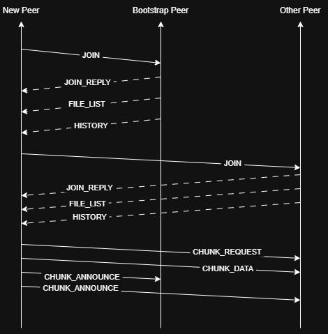
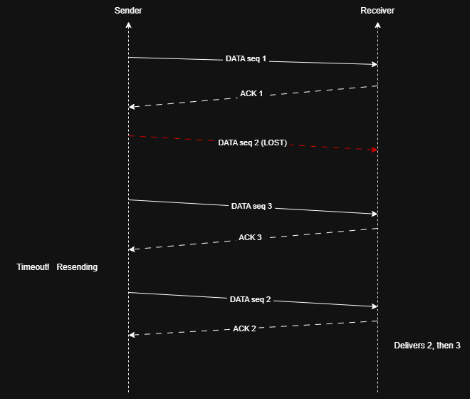

# Protocol Specification

## 1. Packet Header (22 Bytes)
Every packet sent over UDP in this project begins with a 22-byte header. This header ensures that packets can be identified, ordered, and checked for corruption. All fields use big-endian byte order.

| Field | Size | Meaning |
| :--- | :--- | :--- |
| **version** | 1 Byte | Protocol version (always 1). Allows for future updates. |
| **type** | 1 Byte | Message type (e.g., CHAT, ACK, CHUNK_REQUEST). |
| **flags** | 1 Byte | Bit 0 = MORE. Indicates if more fragments of a message follow. |
| **stream** | 1 Byte | 0 = control, 1 = chat, 2 = file. Keeps traffic separated. |
| **sender_id** | 4 Bytes | Random ID of the sending peer. |
| **seq** | 4 Bytes | Packet sequence number (starts at 1). Used for ordering and ACKs. |
| **ack** | 4 Bytes | In an ACK packet, this holds the `seq` being acknowledged. |
| **payload_len**| 2 Bytes | The size of the payload in bytes. |
| **crc32** | 4 Bytes | Checksum of the header (excluding this field) + payload. |

## 2. Message Types
The protocol supports the following message types, routed to the appropriate handlers:

| Type ID | Name | Reliable? | Purpose |
| :--- | :--- | :--- | :--- |
| 1 | JOIN | No | Sent by a new peer to discover others. |
| 2 | JOIN_REPLY | No | Sent by existing peers to welcome a newcomer and share the peer list. |
| 3 | LEAVE | No | Sent when a peer politely exits the network. |
| 4 | HEARTBEAT | No | Sent every 1 second to prove a peer is still alive. |
| 5 | CHAT | Yes | Carries chat text messages. |
| 6 | ACK | No | Acknowledges receipt of a reliable packet. |
| 7 | FILE_LIST | Yes | Shares metadata/manifests of available files. |
| 8 | CHUNK_MAP | Yes | Shares which peers hold which chunks of a file. |
| 9 | CHUNK_ANNOUNCE| Yes | Informs the network that a peer now stores a specific chunk. |
| 10 | CHUNK_REQUEST | Yes | Requests a specific chunk from a peer. |
| 11 | CHUNK_DATA | Yes | Carries the actual binary data of a 32KB chunk. |
| 12 | CHUNK_NACK | Yes | "Negative ACK" - tells a peer they don't have the requested chunk. |
| 13 | HISTORY | Yes | Syncs the last 50 chat messages to a newly joined peer. |

## 3. Expected Message Sequences

**A. Join Flow:**
1. New peer broadcasts `JOIN` (or sends to a bootstrap peer).
2. Existing peers add the new peer and reply with `JOIN_REPLY` (peer list), `FILE_LIST`, `CHUNK_MAP`, and `HISTORY`.
3. The newcomer sends `JOIN` to the peers it just learned about.
4. After ~2 seconds, the newcomer runs `take_share()`, sending `CHUNK_REQUEST` to holders.

**B. Chat Flow:**
1. Sender sends `CHAT` reliably via unicast to every alive peer.
2. Receiver processes the message and sends an `ACK` (handled silently by `reliable.py`).
3. If lost, the timer triggers a resend.

**C. Share (Publish) Flow:**
1. Sharer sends `FILE_LIST` to all peers.
2. Sharer sends `CHUNK_DATA` (Mode 1: "push") to the 2 designated replica holders.
3. Holders save the chunk and broadcast `CHUNK_ANNOUNCE` so all chunk maps update.

**D. Download Flow:**
1. Downloader sends `CHUNK_REQUEST` to multiple peers in parallel.
2. Peers reply with `CHUNK_DATA` (Mode 0: "reply").
3. Downloader verifies SHA-256 for each chunk and the final file.

**E. Failure Recovery Flow:**
1. If heartbeats stop for 5 seconds, the peer is declared dead.
2. Pending requests timeout, and other workers take over the dead peer's chunks.
3. 2 seconds later, `repair()` runs to re-create missing replicas.

## 4. Packet Integrity Proof
The protocol uses CRC32 to detect corrupted packets. As proven in my unit test, if even a single bit is flipped in the payload, the CRC32 check fails, and `parse_packet()` returns `None`, preventing corrupted data from entering the system.

*(See attached screenshot: `javeria_crc_proof.png`)*

## 5. Design Trade-offs
The assignment has no single correct design. The table lists what we chose, what else was possible, and why.

| Topic | Our choice | Alternatives considered | Reason and trade-off |
| :--- | :--- | :--- | :--- |
| **Reliability scheme** | Selective Repeat, window 32 | Stop-and-wait, Go-Back-N | Stop-and-wait wastes the network (one packet per round trip). Go-Back-N resends good packets after one loss. Selective Repeat resends only the lost packet but needs a receiver buffer and one ACK per packet. |
| **Timeout** | Adaptive, 2 x smoothed RTT, min 0.15 s | Fixed 500 ms | Adapts to the network. A very small timeout causes needless duplicates; a large one slows recovery. |
| **Chat delivery** | Reliable unicast to each peer | UDP multicast or broadcast, gossip | Broadcast is unreliable and limited to a LAN. Unicast costs N-1 packets per message but gives guaranteed ordered delivery. |
| **Chat versus file throughput** | Separate stream per traffic type | One shared sequence space | Chat messages are not stuck behind large file transfers. |
| **Chunk size** | 32 KB | 4 KB, 1 MB | Small chunks give more parallelism and finer failover but a longer manifest and more requests. |
| **Replication factor** | R = 2 | R = 1, R = 4 | R = 1 loses data when a peer dies. R = 4 means every peer holds the whole file. R = 2 survives one failure at 2x storage. |
| **Replica placement** | Sorted ids, round robin | Random, consistent hashing | Deterministic: every peer computes the same result with no coordination. |
| **Failure detection** | Heartbeat 1 s, timeout 5 s | 0.5 s / 2 s, 3 s / 15 s | Shorter detects faster but gives false alarms under packet loss; longer is robust but slow. |
| **Download strategy** | Worker per source, end-game re-requests | One source at a time | Parallel speed and fast failover, at the price of a few duplicate requests at the end. |
| **Integrity** | CRC32 per packet, SHA-256 per chunk and file | CRC only | SHA-256 also detects corruption on disk and wrong data from a faulty peer. |

### 5.1 Experimental Results (Unit Test Proof)
As seen in our unit test (`test_reliable.py`), with 20% packet loss, all 100 messages arrived in order. However, when we simulated 50% loss, the test timed out because the sender spent all its time retransmitting. When we removed the ACK for duplicates, the sender got stuck in an endless loop. This proves that while Selective Repeat with adaptive timeouts has overhead, it is absolutely necessary for guaranteeing order and preventing infinite loops in lossy networks.

## 6. Chat History and Storage Maintenance

### 6.1 Chat History
Every chat message is appended to a local history file on disk (`chat_history.log`). When a new peer joins the network, existing peers send them a `HISTORY` message (reliable, Stream 1) containing the last 50 chat messages. The newcomer merges these messages and skips duplicates by checking the sender ID, timestamp, and text. This ensures that a user who joins late can still see the recent conversation context.

### 6.2 Storage Maintenance
To keep the distributed storage healthy, the system performs integrity checks (`/scrub`) to recompute SHA-256 hashes of stored chunks and re-download corrupt ones. It also performs cleanup (`/cleanup`) to remove orphaned chunks and extra copies, ensuring exactly `R` (2) copies exist per chunk. After a restart, a peer re-announces its existing chunks so they are not downloaded again.

## 7. Flow Diagrams

### Figure 2: Header Layout

### Figure 3: Join Sequence

### Figure 4: Reliable Send with Lost Packet

### Figure 5: Group Chat Flow
